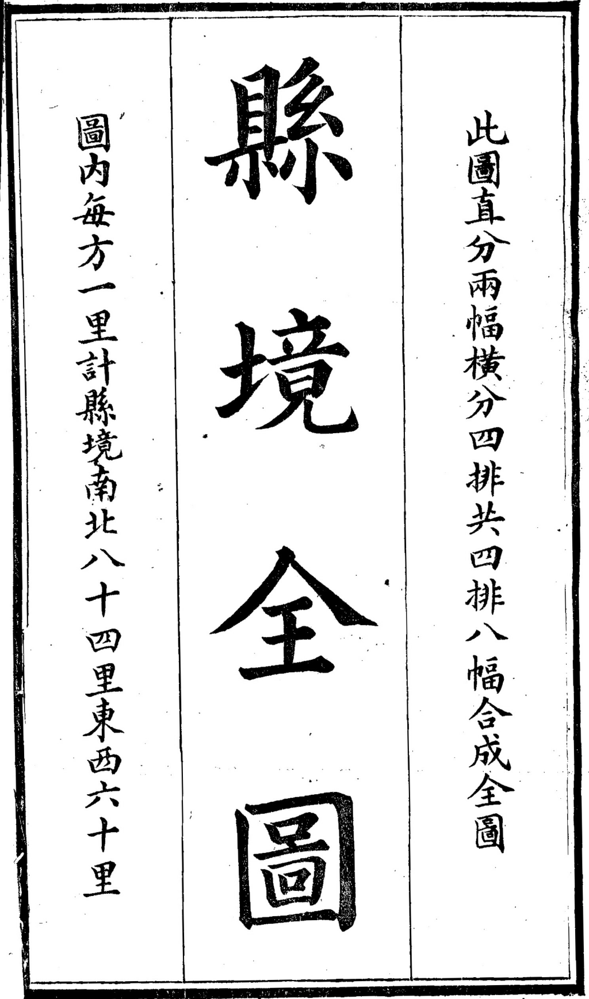
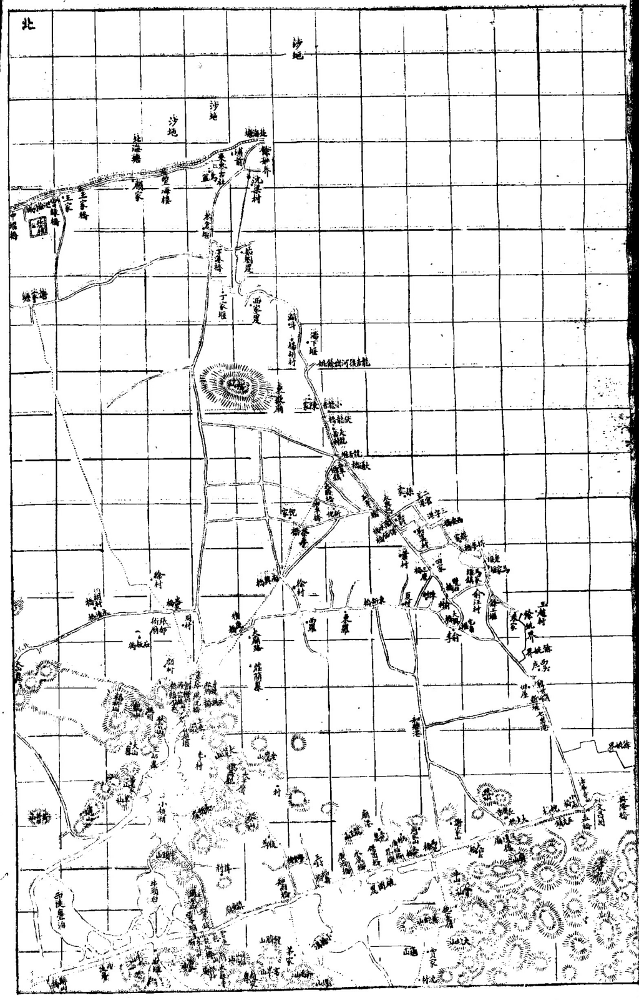
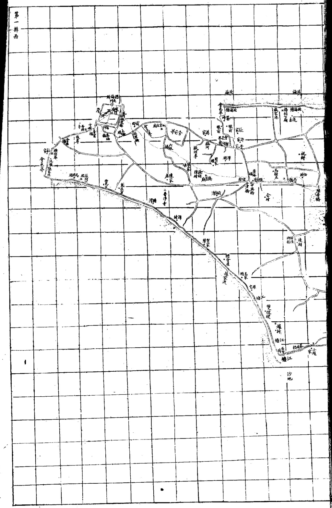
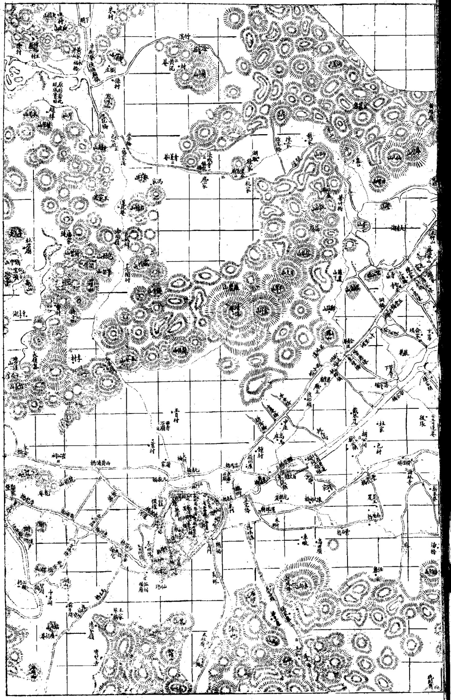
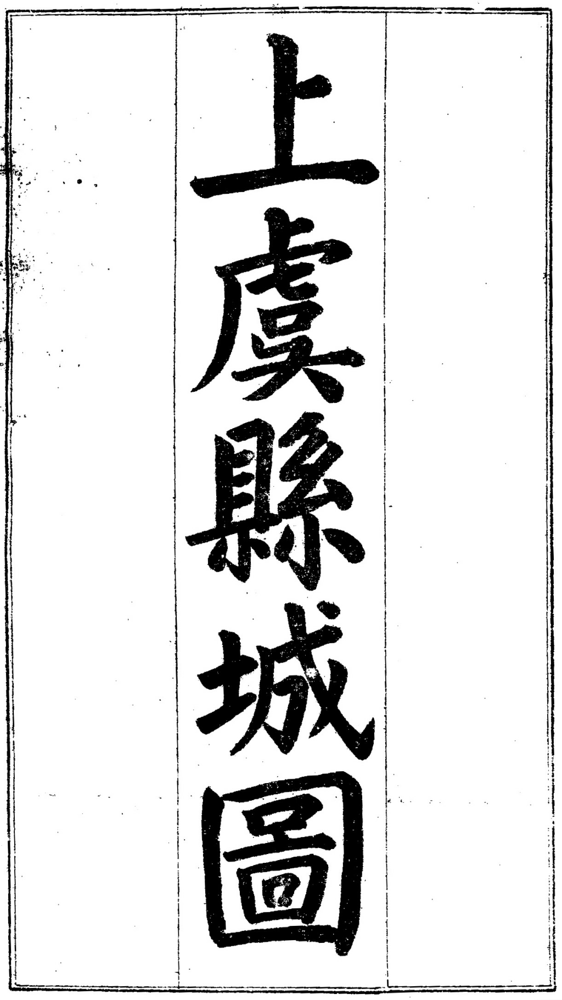
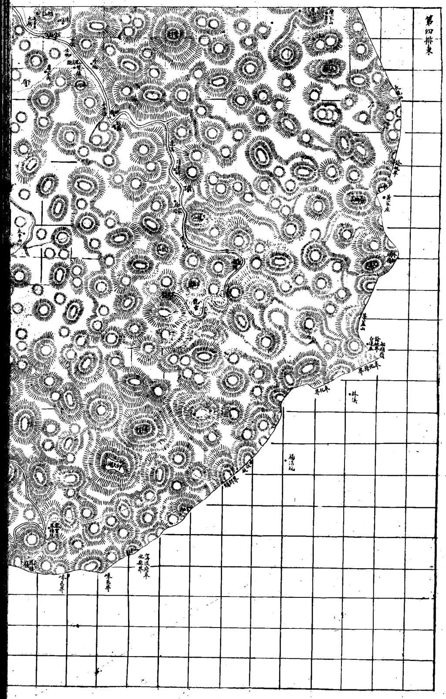
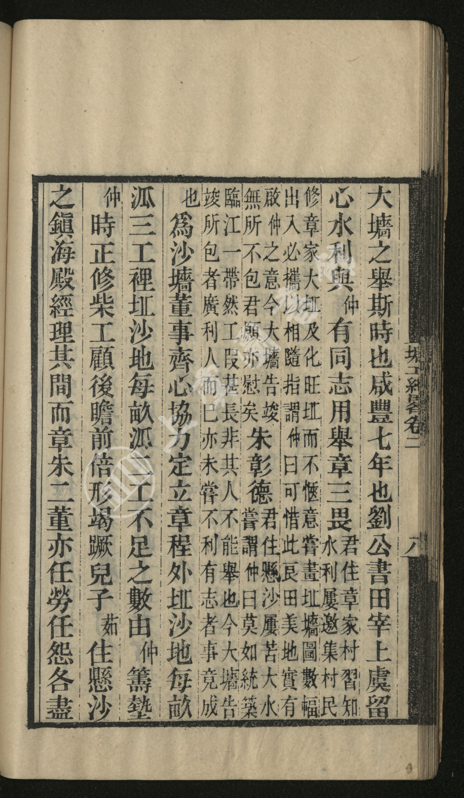
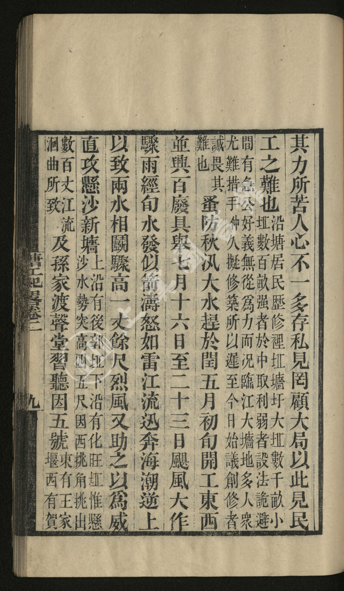
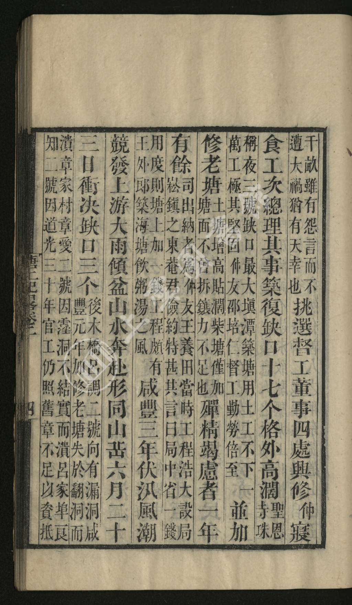
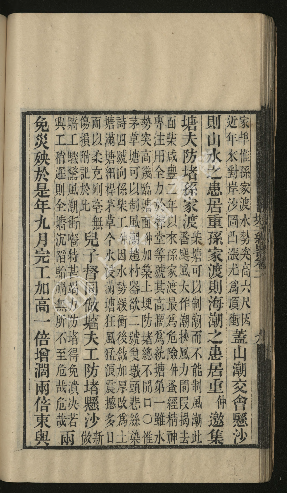

# 悬沙 · 头甲至五甲 老地图与今地定位

**——光绪《上虞县志》「县境全图」＋《塘工纪略》＋今地实测（三源对读）**

> 承〈悬沙头甲至五甲·地名考〉。前篇考「悬沙」「甲」名从哪来；本篇专答：**有老地图吗？五甲村到底在哪？**

---

## 〇、一句话结论

1. **老地图有，而且是原刻本**：光绪《上虞县志》卷首「**縣境全圖**」八幅（**圖内每方一里**，縣境南北 84 里、東西 60 里）＋「上虞縣城圖」，连同《民國重修上虞縣志》《**塘工紀畧**》，已从上虞图书馆古籍库**整册下载到本地**（见 §六 影像清单）。
2. **但老图上找不到「头甲～五甲」**：光绪志成书（1891）时，那一片在图上只写作「**沙地**」，图上出现的是「北海塘／百瀝海塘／崧廈／瀝海所／曹娥江」这类大区名。**甲名要等 1925 年宗谱才见诸文字。**
3. **五甲村的具体位置，靠「四至＋今地标＋坐标」三步定**：悬沙片＝曹娥江东岸，**东至百沥海塘（前江村）· 南至梁祝大道（三环）· 西至曹娥江 · 北至虞舜大道（四环）**，面积 15.64 km²。
4. ★ **本次新挖到一部原典——《塘工紀畧》**（连仲愚撰，咸丰七年成事，上虞图书馆古籍库藏本，索书号 A1187）：里面「**章三畏君住章家村**」「**朱彰德君住懸沙**」两句话，是**谱外文献里第一次出现「章家村」三字**，并把「懸沙」这个地名**前推到 1857 年**（比 1934 年保甲制早 77 年）。

---

## 一、老地图：找到什么

| 书 | 版本 / 性质 | 所载图 | 数字源 | 本次取用 |
|---|---|---|---|---|
| **光绪《上虞县志》** | 光绪十七年（1891）刻本，35 册 | **卷首「縣境全圖」八幅**（4 排 × 東/西 各幅）＋「上虞縣城圖」＋學宮圖／縣署圖／經正書院圖 | 上虞图书馆古籍库（`sylibguji.mh.chaoxing.com`，IP 授权） | **整册 182 页已下载**，取 6 幅 |
| **《民國重修上虞縣志》** | 民国印本，2 册 | 另有图说 | 同上 | 93 页已下载（备用） |
| **《塘工紀畧》** | 连仲愚撰（咸豐七年創修臨江大牆），合 卷一二·續·三續 一册；**索书号 A1187** | 文中自述「**嘗畫坵𡓜圖數幅**」 | 同上 | **176 页已下载＋全册 OCR** |
| 《上虞雁埠陆氏宗谱》 | 民国，6 册 | — | 同上 | 待取（雁埠在同里的第二部族谱） |

> **《縣境全圖》题记原文**（光绪志 卷首 p0124）：
> 「此圖**直分兩幅、横分四排，共四排八幅合成全圖**。……**圖内每方一里**，計縣境**南北八十四里、東西六十里**。」

**获取方式（实测可行，留给后人复验）**
`https://sylibguji.mh.chaoxing.com/` → 检索「上虞县志」→ 资源详情页 → 点「阅读」→ 影像接口
`https://zt.chaoxing.com/reader/blobPdfImg?readerKey=<key>&unitId=8481&page=<N>`
（`readerKey` 必须在浏览器里**实地点开一次**才生效；影像上限宽 1024 px。）

### 1.1 图影（原刻影像，本地已存）

**光绪《上虞县志》卷首 · 縣境全圖**

@@gal

@@end

**连仲愚《塘工紀畧》（咸豐七年创修临江大牆主事人自记）**

@@gal

@@end

---

## 二、老图上到底有没有「头甲～五甲」？——两道验证，都是否定

### 验证一：逐幅识读（光绪志 卷首 p0125–p0137）

把 13 幅图逐页放大看过，北部各幅出现的地名是：

| 幅 | 页 | 可辨地名（摘） |
|---|---|---|
| 北部沙地幅 | p0126 | **沙地**（两处）、**北海塘**、塍海樓／望海樓、顧家、王家橋、王家、德和號、中堰橋、塘家橋、沈梁村、前浦、丁家堰、西家堰、湯下堰、葛胡村、**東嶽廟**、**崧廈**（带放射状城符）、**餘姚界**、**白馬湖**、小査湖、西陡亹湖、牛頭山 |
| 第一排西 | p0128 | **曹娥江**、**北海塘**、**瀝海所**（方城，有北門／南門）、**會稽界**、華鎮塘、孫家渡、賀家埠、毛家堰、塘灣、譚村、南湖、金雞橋、中興橋、橫河李、德星庵 |
| 第二排 | p0130／p0131 | 曹娥江、會稽界、密集聚落 |
| 第四排 | p0137 | 四明山區 |

→ **图上只有「沙地」这种地貌名，没有「頭甲／二甲／三甲／四甲／五甲」。**

### 验证二：古籍库全书检索（同一书库，全文索引）

| 检索词 | 命中 | 命中书 |
|---|---|---|
| **五甲** | **0** | — |
| **二甲** | **0** | — |
| **懸沙** | 2 | 《塘工紀畧》 |
| **章三畏** | 1 | 《塘工紀畧》 |
| 雁埠 | 2 | 《上虞雁埠章氏宗谱》《上虞雁埠陆氏宗谱》 |

### 为什么图上没有？——两点解释，不要误读

- **不是「当时没有这片地」**：《塘工紀畧》咸豐七年（1857）已写「**朱彰德君住懸沙**」「**章三畏君住章家村**」——**人呢、村呢，都在**。
- **是「村落名还没进县级图」**：光绪志县级图每方一里，只标塘、镇、渡、山、江这类要冲，「沙地」是一片**面**，村落不单独上图注；加上刻本地名本就择要而书。
- ⚠️ 按识图存档规矩，此处下的是**「已查来源清单内的否定」**，不是「不存在」：本条否定覆盖 ① 光绪志卷首图 13 幅逐页目验 ② 古籍库全文检索。**若日后见到「×甲」字样更早的图（如 1912–1934 年五万分之一实测地形图），本条须即时修订。**

---

## 三、五甲在哪里：四至 ＋ 逐甲定位表

### 3.1 四至（官修口径）

> 「**悬沙**是片名，系百官镇原**头甲、二甲、三甲、四甲、燕子窠、大王家、下王家** 7 个自然村之总称。地处**曹娥江东岸**，**东至百沥海塘（前江村），南至梁祝大道（三环），西至曹娥江，北至虞舜大道（四环）**。」
> ——〈「悬沙」之变〉，浙江日报 2019-02-12

另一版（2023《虞你说地名》）记悬沙片「东南起**百官街道中利村**，西北至**崧厦街道吕家埠**，南临曹娥江，北依百沥海塘，**总面积 15.64 平方公里**」。

### 3.2 逐甲定位表

| 甲 | 今属 | 今地标／坐标（GCJ-02） | 沿革要点 |
|---|---|---|---|
| **头甲** | **百官街道 头甲社区** | 头甲公寓 `30.0455, 120.8545` | 1961 年**头甲大队（含大王家、小王家）**；社区一带即原头甲自然村 |
| **二甲** | **百官街道 二甲社区** | `30.0431, 120.8455`（代码 330604001040；东临四甲、南临头甲、西临职教中心、北临体育中心，占地 16 万 m²） | 1961 年**二甲大队（含三甲）** |
| **三甲** | **无今地名**（已并入二甲） | 旧址约 `30.046, 120.850` 一带（**约略**） | ★ **1961 年三甲并入二甲大队**；三甲渡 2006 年停渡、无桥承名 → **名亡**（对照：五甲名存，见下） |
| **四甲** | **百官街道 四甲社区** | 四甲新家园 `30.0494, 120.8513` | 1961 年**四甲大队（含燕子窠）** |
| **五甲·内** | **崧厦街道 内五甲村**（2012 年起曹娥街道托管） | 村域在沙塘以内 | 「以**沙塘**为界，塘内＝内五甲，塘外＝外五甲」 |
| **五甲·外** | **崧厦街道 外五甲村** | `30.0507, 120.8271`（代码 330604005233） | 明末清初章氏来此开荒所立；三面临江；**1995 裁弯取直**后免涝；2020 已列征迁 |
| **五甲渡** | 桥梁／公园承名 | 五甲渡大桥 `30.0560, 120.8176`（1995 五甲渡桥 → 2013 五甲渡大桥 → **2025.3 五甲渡城市公园**） | **渡废名存**，故今图上找得到五甲渡 |

**排布方向**：沿曹娥江，**自东南（上游·百官）向西北（下游·吕家埠）**依次编号：头甲 → 二甲 → 三甲 → 四甲 → 五甲。故 **头甲最近百官，五甲最近吕家埠**。这与「章氏住三甲 → 章家义渡在近三甲渡」「外五甲村以章姓为主」两事地理上完全自洽。

> 📍 **交互地图**：同目录 **`雁埠今地·地图.html`** 已把这 7 个点位（头甲／二甲／三甲／四甲／内五甲／外五甲／五甲渡）标到腾讯地图上，可按「头甲～五甲」分类筛选、逐点看沿革。

---

## 四、老图 ↔ 今图：同一片地，四次沧海桑田

| 时间 | 那一片在图上／文里是什么 |
|---|---|
| **1891 光绪志图** | 只写「**沙地**」——北面杭州湾，西面曹娥江，近旁只有**瀝海所**、**崧廈**两个大镇，江边一道**塘**（沙墙） |
| **1857《塘工紀畧》** | 「章三畏君住**章家村**」「朱彰德君住**懸沙**」「直攻**懸沙新牆**」——**村已立，牆初成** |
| **1925 宗谱** | 族人「住**懸沙二甲／三甲／五甲**」（册 05、册 07 世录实测）——**甲名入谱** |
| **1940 / 1961 / 1995 / 2006 / 2025** | 王公沙塘分内·外五甲 → 三大队并村（三甲亡）→ 裁弯取直 → 三甲渡停渡 → 五甲渡城市公园 |

**一句话**：1891 年地图上那片空白的「沙地」，正是今天头甲～五甲的七个社区／村；**图的空白不是没内容，是当时还没有可上县图的地名。**

---

## 五、★ 新证：《塘工紀畧》（本次新挖的第一手原典）

**出处**：连仲愚撰，上虞图书馆古籍库藏本，**索书号 A1187**（合「塘工紀畧卷一至二／續塘工紀畧／三續塘工紀畧」为一册，影像共 176 页）。本书是**咸豐七年（1857）创修临江大牆**的主事人自记，正是《章氏宗谱》卷九、卷十那条治江事的上游原始文献。

**本次已把全书 176 页下载并做古籍 OCR**，可精确定位：**「章家村」见影像 p75、p84；「章三畏」见 p84；「懸沙」见 p84、p85；「臨江大𡓜」见 p85、p121；「沙𡓜」见 p71、p81–84、p121**。

### 5.1 两段原文（校录）

**其一（章三畏主事）——影像 p84**
> 「大牆之舉，斯時也**咸豐七年**也。**劉公書田宰上虞**，留心水利，與仲有同志，用舉**章三畏君住章家村**，習知水利，**屢邀集村民修章家大坵及化旺坵**而不愜意，**嘗畫坵𡓜圖數幅**，出入必攜以相隨，指謂仲曰：『可惜此良田美地……』實有啟仲之意。今大牆告竣，無所不包，君願亦慰矣。**朱彰德君住懸沙**，屢苦大水，嘗謂仲曰：『莫如統築臨江一帶。』然工叚甚長，非其人不能舉也。今大牆告竣，所包者廣，利人而已，亦未嘗不利有志者……」

同页紧接一句，是**沙墙的董事与派工章程**：
> 「……爲**沙𡓜董事**，齊心協力，定立章程：**外坵沙派三工，裡坵沙地每畝派二工**，不足之數由仲〔墊〕……而**章、朱二董亦任勞任**〔怨〕……」

**其二（懸沙水势）——影像 p85**
> 「……如雷，江流迅奔，海潮逆上，以致兩水相鬭，驟高一丈餘尺，烈風又助之以爲威，**直攻懸沙新牆**。上沿有**後郭坵**，下沿有**化旺坵**，惟**懸沙水勢突高四五尺**，因西挑角挑出數百丈，江流洄曲所致，及**孫家渡**……」

**其三（孫家渡险工）——影像 p86**
> 「……家埠，惟**孫家渡水勢突高六尺**……近年來對岸沙圖凸漲尤爲頂衝……**咸豐二年以來孫家渡最爲危險**，仲蚤〔早〕專注用全力於聲堂等號，其高濶爲統塘第一。」

**其四（最早一条「章家村」）——影像 p75**
> 「**咸豐三年伏**〔汛〕……三日衝决缺口三个……〔咸〕豐元年加修老塘，失於〔防〕，**潰章家村章愛二號**，因霔洞不結實而潰；呂知二號因道光三十年官工仍照舊章，不足禦而潰。」
> → **「章家村」早在咸豐三年（1853）的潰塘记录里就出现了**，比咸豐七年还早 4 年。

### 5.1b 三条旁证

- 「**崧鎭**之東菴」——连仲愚的董事班子里有「**崧鎮**」（今崧厦镇）人，说明沙墙工程本就是**崧厦—雁埠**一片的联合工程。
- 「**聖恩寺、錢庫廟、施家堰**」——p82 附近记沙地缺口的常见发生处（「口多由居民開掘，總在**聖恩寺、錢庫廟、施家堰**」）。**「聖恩寺」正是宗谱册 07 记泰安「墓在前江聖恩寺南首」的那座寺**；「施家堰」与 1956 年「悬沙＋**施家堰**成立悬沙高级社」相合。
- 「**賀家埠**」（p86「……家埠」）——与光绪志图 p0128 上实地标注的「**賀家埠**」对上。

### 5.2 五条要点

1. ★★ **「章三畏君住章家村」**——**谱外文献第一次出现「章家村」三字**。谱内只作「雁埠」「章家」，此书直书「章家村」，且与今日崧厦街道**章家村**同名，跨越 168 年。
2. ★ **「朱彰德君住懸沙」**——**「懸沙」在 1857 年已是地名**（另一首事亦住此）。前篇记「1934 年保甲制，甲名从此成为村名」，**此条须修正为**：地名（懸沙）1840 年代前已有，「甲」制是**再沿用**。
3. **章三畏的能事**：「習知水利」「屢邀集村民」「嘗畫坵𡓜圖數幅」——**他能集村民、能画墙图**，正是前篇所考「雁埠团第一认粮大户」（章大輔户 66 官丁，占全团 414 官丁约 16%）该有的样子；两文互补。
4. **沙丘（坵）名三种**：**章家大坵、化旺坵、後郭坵**——「上沿有後郭坵，下沿有化旺坵」。这是悬沙内部更细的地块命名，可备族属实地认地。
5. **渡／堰名**：「**孫家渡**」「王家堰」（其二文末）——**光绪志图 p0128 上恰有「孫家渡」「毛家堰」**，两个数字源在图上对上了。

### 5.3 与宗谱的三项咬合（复核通过）

| 项 | 《塘工紀畧》 | 《章氏宗谱》 | 合 |
|---|---|---|---|
| 人名 | 章三畏 | 卷十〈章三畏公傳〉：諱**東序**，字**三畏**，泳公第三子 | ✅ |
| 年份 | 咸豐七年 | 卷九「咸豐七年知縣劉書田與連仲愚先生商水利，用三畏公議創修臨江大牆」 | ✅ |
| 工长 | 大牆告竣，包者廣 | 卷十「工長**三千六百丈**」 | ✅ |
| 主官 | **劉公書田宰上虞** | 卷九「知縣**劉書田**」 | ✅ |

---

## 六、影像清单（本地文件）

目录：`上虞雁埠章氏宗谱\04_接谱\老地图影像\`

| 文件 | 内容 |
|---|---|
| `01_光绪上虞县志_上虞县城图_p0122.png` | 上虞縣城圖（舊縣治豐惠） |
| `02_光绪上虞县志_县境全图_题记_p0124.png` | 「縣境全圖」题记（每方一里／南北84里‧東西60里） |
| `03_光绪上虞县志_县境全图_北部幅_沙地与崧厦_p0126.png` | 北部幅：**沙地**·北海塘·崧廈·白馬湖 |
| `04_光绪上虞县志_县境全图_第一排西_曹娥江与沙塘_p0128.png` | **第一排西**：**曹娥江**·瀝海所·會稽界·孫家渡·沙塘 |
| `05_光绪上虞县志_县境全图_第二排_曹娥江中段_p0130.png` | 第二排：曹娥江中段密集聚落 |
| `06_光绪上虞县志_县境全图_第二排西_p0131.png` | 第二排西（带幅名） |
| `07_光绪上虞县志_县境全图_第四排_四明山区_p0137.png` | 第四排：四明山區 |

目录：`上虞雁埠章氏宗谱\04_接谱\塘工纪略影像\`

| 文件 | 内容 |
|---|---|
| `01_塘工纪略_p075_咸丰三年溃章家村章爱二号.png` | 咸豐三年伏汛决口，「潰**章家村**章愛二號」 |
| `02_塘工纪略_p084_咸丰七年举章三畏住章家村.png` | ★「**章三畏君住章家村**」「**朱彰德君住懸沙**」＋沙墙董事派工章程 |
| `03_塘工纪略_p085_直攻悬沙新墙_後郭坵化旺坵.png` | ★「**直攻懸沙新牆**，上沿有後郭坵，下沿有化旺坵」 |
| `04_塘工纪略_p086_孙家渡最为危险.png` | 「**孫家渡**」，咸豐二年以来最险 |

另存：《塘工紀畧》全书 176 页影像＋古籍 OCR 文本（工作副本存 `WorkBuddy/tmp_map/`，未入成果件；如需某页可再导）。

---

## 七、存疑与待核（含对前篇的修订）

1. **修订前篇「1934 保甲说」**：`《塘工紀畧》（1857）已见「懸沙」` → 「懸沙」是**早于保甲制**的老地名；「×甲」作为**村名**最迟 1925 年已在谱中通行。故「甲」的来源仍以**盐务灶甲／社甲**为本，1934 保甲制只是**再沿用**。→ 已同步修订〈地名考〉§二、§五。
2. **「章家村」同名跨 168 年**：1857 年的「章家村」与今崧厦街道章家村是否同一聚落（抑或「章家村」古为泛称、今为 2006 年四村合并后的行政村名），待以更早都图／保图核。
3. **三甲的准确定位**：今无同名地标，本表坐标是「约略」。可查方向：① 原三甲渡渡址（谱〈三渡六桥说今古〉）② 1961 年二甲大队的原始大队界 ③ 族中老人指认。
4. **头甲、四甲谱内无「住」注**（前篇存疑 6）——仍待族属实地核：是章氏确无人居，抑或漏记。
5. **图上甲名**：光绪志（1891）图上确无甲名（本篇 §二）；若能调阅 **1912–1934 年五万分之一实测地形图**（陆军测量局）或民国《上虞县图》，有机会看到「甲」字首次上图。本条留待后续。

---

## 八、来源清单（本篇新增）

- **光绪《上虞县志》**卷首（上虞图书馆古籍库藏本，整册 182 页；「縣境全圖」八幅）——**新**
- **连仲愚《塘工紀畧》**（上虞图书馆古籍库藏本，索书号 **A1187**；含續、三續）——**新** ★
- 《上虞雁埠陆氏宗谱》（同上书库，6 册）——**新（仅著录）**
- 《民國重修上虞縣志》（同上书库，2 册）——**新（备用）**
- 〈「悬沙」之变〉，浙江日报／浙江新闻客户端，2019-02-12（四至与 1961 建队）
- 《虞你说地名·上虞地名文化寻迹》（上虞区民政局编，中国文史出版社 2023，p123）（悬沙片 15.64 km²）
- 博雅地名网／百度百科：头甲社区、二甲社区、四甲社区、内五甲村、外五甲村
- 坐标：腾讯地图／OpenStreetMap（五甲渡大桥 30.0560,120.8176）；社区点位为地图检索实测值

---

*编制：据宗谱十三册（民国十四年乙丑·1925 星聚堂木活字本）＋光绪《上虞县志》＋《塘工紀畧》＋今地实测，四源对读。凡「约略」字样者均非实测，勿引用。*
